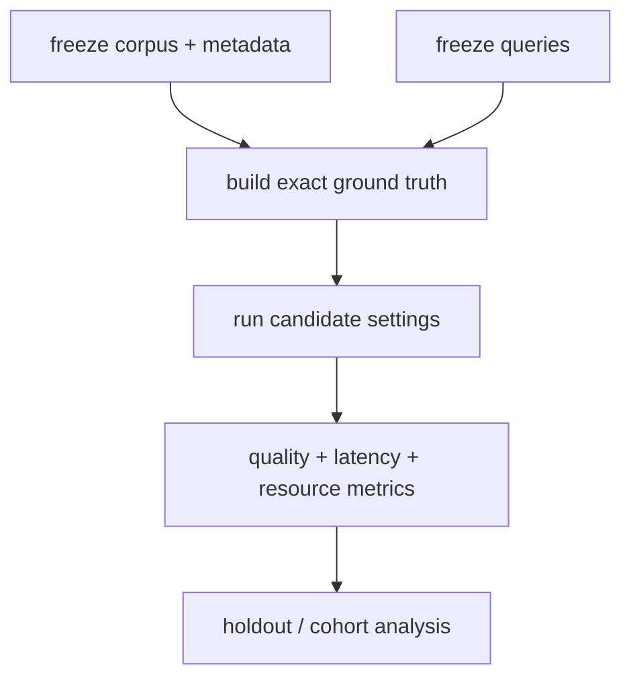

# Build a retrieval evaluation

> **TL;DR:** A credible evaluation fixes a corpus snapshot, query set, relevance or exact-neighbor ground truth, and a repeatable load profile before tuning.

**Figure 1: Simplified conceptual view of this topic.**

**Takeaway:** Follow the arrows to see where the method spends work and where the main trade-off enters.

### How to read this

- Follow arrows in the direction data or decisions move.
- The labels name the main components; they do not promise a specific implementation.
- Use the table and field notes below to connect the picture to measurements.

**Visual takeaway:** The diagram shows the main data or decision path; labels are conceptual, not performance guarantees.

## Field notes

For ANN, exact top-k ground truth can be computed in batches with the target metric. For application relevance, label query-document pairs or use a judged benchmark; vector recall alone does not measure answer quality. Separate tuning and holdout queries, preserve filter cohorts, and retain raw results with environment metadata.

## Sources

[ANN-Benchmarks](https://ann-benchmarks.com/) · [Big ANN benchmarks](https://big-ann-benchmarks.com/). Product behavior and defaults can vary by release; pin the version used in any benchmark.

**Next:** [Master index](../00-INDEX.md) · [Glossary](../99-glossary.md).
