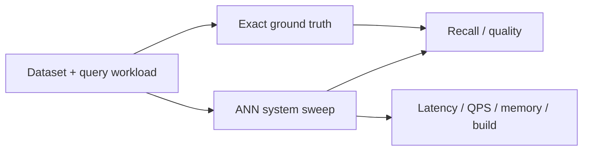

# Evaluation and Benchmarking

> [!TIP] **TL;DR:** Evaluate quality against exact ground truth and report latency distributions, throughput, memory, build/update cost, and workload details together. Planned notes are `todo`.

**Figure E1.** Evaluation flow.  
**Takeaway:** A recall number without workload, aggregation, and resource measurements is not a useful system comparison.

| File | Focus | Status |
|---|---|---|
| [Metrics](01-metrics-recall-qps-latency.md) | Recall, QPS, latency percentiles | todo |
| [ANN benchmarks](02-ann-benchmarks-and-big-ann.md) | Dataset and benchmark methodology | todo |
| [Build your own eval](03-building-your-own-eval.md) | Reproducible experiment | todo |

**Start here:** [Metrics](01-metrics-recall-qps-latency.md).

