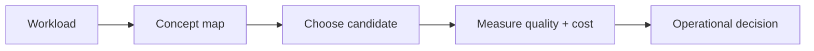

# Evaluation and benchmarking

> **TL;DR:** Follow the visual map, then open a focused note for the assumptions, measurement, and references.

**Figure 1: Simplified study path through this section.**

**Takeaway:** Move from the shared foundation to one method at a time, then validate with measurements.

| Topic | Use |
|---|---|
| [Metrics](01-metrics-recall-qps-latency.md) | Start here for the decision summary and linked deep note. |
| [Public benchmarks](02-ann-benchmarks-and-big-ann.md) | Start here for the decision summary and linked deep note. |
| [Build an evaluation](03-building-your-own-eval.md) | Start here for the decision summary and linked deep note. |

**Start here:** [Metrics](01-metrics-recall-qps-latency.md).

**Next:** [Vector databases master index](../00-INDEX.md).
