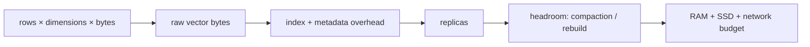

# Capacity planning and cost

> **TL;DR:** Start with raw vector bytes, then add index, metadata, replicas, compaction headroom, and peak rebuild capacity.

**Figure 1: Simplified conceptual view of this topic.**

**Takeaway:** Follow the arrows to see where the method spends work and where the main trade-off enters.

### How to read this

- Follow arrows in the direction data or decisions move.
- The labels name the main components; they do not promise a specific implementation.
- Use the table and field notes below to connect the picture to measurements.

**Visual takeaway:** The diagram shows the main data or decision path; labels are conceptual, not performance guarantees.

## Field notes

For 100M × 768 float32 values, raw vectors alone are 307.2 GB decimal (about 286 GiB). This excludes IDs, metadata, graph edges, allocator overhead, replicas, and temporary build space. Use measured per-record index overhead and plan peak coexistence during model/index migrations.

## Sources

[ANN survey](https://arxiv.org/abs/1806.09823) · [FAISS paper](https://arxiv.org/abs/1702.08734). Product behavior and defaults can vary by release; pin the version used in any benchmark.

**Next:** [Master index](../00-INDEX.md) · [Glossary](../99-glossary.md).
