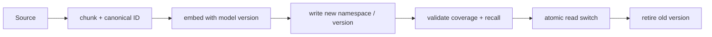

# Ingestion and reindexing

> **TL;DR:** Treat embedding generation and index changes as versioned data migrations with idempotent writes, checkpoints, and rollback.

**Figure 1: Simplified conceptual view of this topic.**

**Takeaway:** Follow the arrows to see where the method spends work and where the main trade-off enters.

### How to read this

- Follow arrows in the direction data or decisions move.
- The labels name the main components; they do not promise a specific implementation.
- Use the table and field notes below to connect the picture to measurements.

**Visual takeaway:** The diagram shows the main data or decision path; labels are conceptual, not performance guarantees.

## Field notes

Make retries idempotent and record model, preprocessing, and chunker versions. Dual-write or backfill into a separate version, validate count and quality, then switch reads gradually. Keep rollback possible until the new path meets freshness, latency, and relevance gates. Avoid mixing incompatible embedding spaces in one index without explicit routing.

## Sources

[BEIR](https://arxiv.org/abs/2104.08663) · [RAG paper](https://arxiv.org/abs/2005.11401). Product behavior and defaults can vary by release; pin the version used in any benchmark.

**Next:** [Master index](../00-INDEX.md) · [Glossary](../99-glossary.md).
