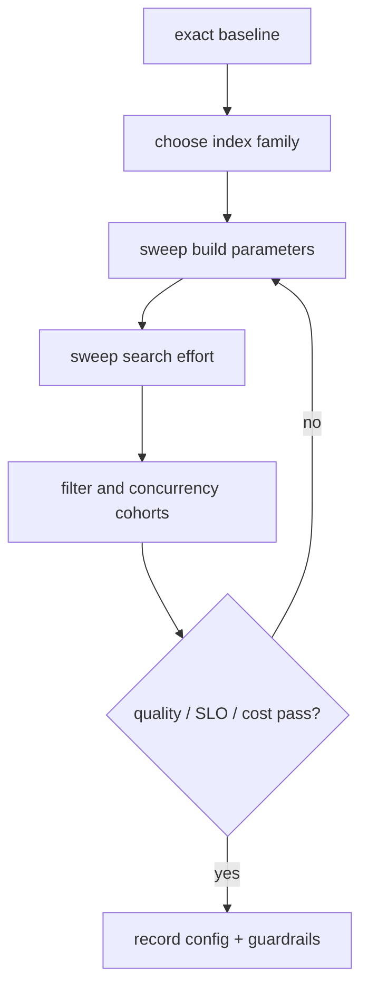

# ANN tuning playbook

> **TL;DR:** Tune one factor at a time against exact ground truth and a fixed workload; stop when quality and SLO gates are met within budget.

**Figure 1: Simplified conceptual view of this topic.**

**Takeaway:** Follow the arrows to see where the method spends work and where the main trade-off enters.

### How to read this

- Follow arrows in the direction data or decisions move.
- The labels name the main components; they do not promise a specific implementation.
- Use the table and field notes below to connect the picture to measurements.

**Visual takeaway:** The diagram shows the main data or decision path; labels are conceptual, not performance guarantees.

## Field notes

First establish metric semantics and exact top-k. Then sweep a small, documented grid: IVF probes, HNSW search effort, PQ code size, candidate depth, or rerank count as applicable. Track build time and memory as well as query results. Re-run under realistic filtering and concurrency before production.

## Sources

[ANN-Benchmarks](https://ann-benchmarks.com/) · [Big ANN benchmarks](https://big-ann-benchmarks.com/). Product behavior and defaults can vary by release; pin the version used in any benchmark.

**Next:** [Master index](../00-INDEX.md) · [Glossary](../99-glossary.md).
