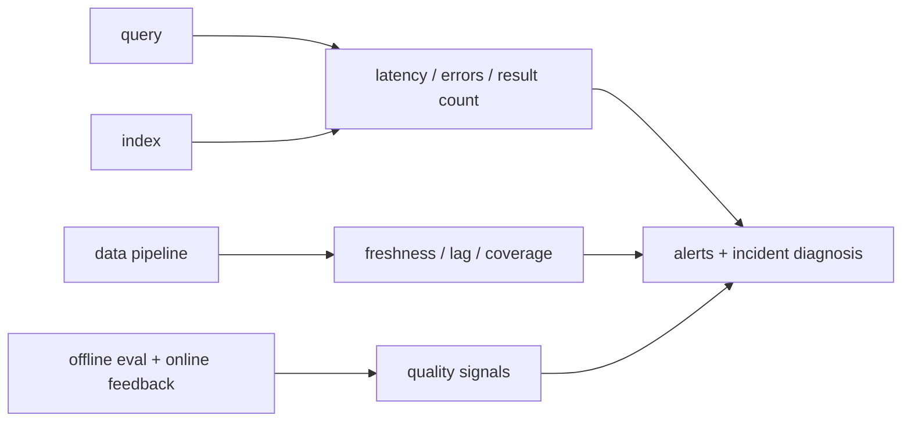

# Observability and failure modes

> **TL;DR:** Observe retrieval quality, workload health, and data freshness together; latency dashboards alone cannot detect silent relevance regressions.

**Figure 1: Simplified conceptual view of this topic.**

**Takeaway:** Follow the arrows to see where the method spends work and where the main trade-off enters.

### How to read this

- Follow arrows in the direction data or decisions move.
- The labels name the main components; they do not promise a specific implementation.
- Use the table and field notes below to connect the picture to measurements.

**Visual takeaway:** The diagram shows the main data or decision path; labels are conceptual, not performance guarantees.

## Field notes

Useful slices include tenant, filter selectivity, query cohort, index version, and model version, subject to privacy limits. Monitor p50/p95/p99, timeout and empty-result rates, ingestion lag, segment/compaction backlog, memory, cache misses, and sampled relevance. Establish alert thresholds from SLOs and baselines rather than generic constants.

## Sources

[ANN-Benchmarks](https://ann-benchmarks.com/) · [Big ANN benchmarks](https://big-ann-benchmarks.com/). Product behavior and defaults can vary by release; pin the version used in any benchmark.

**Next:** [Master index](../00-INDEX.md) · [Glossary](../99-glossary.md).
