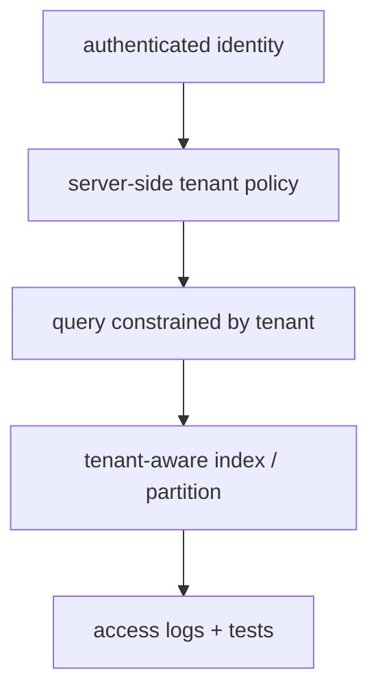

# Multi-tenancy and security

> **TL;DR:** Tenant isolation must be enforced in the query path and data layout; a client-supplied filter alone is not an authorization boundary.

**Figure 1: Simplified conceptual view of this topic.**

**Takeaway:** Follow the arrows to see where the method spends work and where the main trade-off enters.

### How to read this

- Follow arrows in the direction data or decisions move.
- The labels name the main components; they do not promise a specific implementation.
- Use the table and field notes below to connect the picture to measurements.

**Visual takeaway:** The diagram shows the main data or decision path; labels are conceptual, not performance guarantees.

## Field notes

Derive tenant scope from trusted identity, enforce it server-side, and test adversarial combinations of filters, IDs, aliases, and reranking caches. Decide whether shared indexes, partitions, or per-tenant indexes meet isolation and noisy-neighbor needs. Encrypt data and backups, minimize logged payloads, and validate deletion propagation.

## Sources

[OWASP LLM Top 10](https://genai.owasp.org/llm-top-10/) · [NIST AI RMF](https://www.nist.gov/itl/ai-risk-management-framework). Product behavior and defaults can vary by release; pin the version used in any benchmark.

**Next:** [Master index](../00-INDEX.md) · [Glossary](../99-glossary.md).
