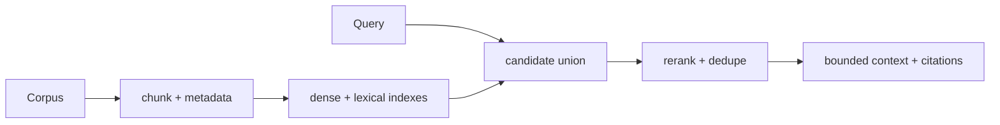

# Retrieval for RAG

> **TL;DR:** Optimize evidence coverage and answer usefulness, not nearest-neighbor recall alone; chunking, lexical retrieval, reranking, and context assembly all matter.

**Figure 1: Simplified conceptual view of this topic.**

**Takeaway:** Follow the arrows to see where the method spends work and where the main trade-off enters.

### How to read this

- Follow arrows in the direction data or decisions move.
- The labels name the main components; they do not promise a specific implementation.
- Use the table and field notes below to connect the picture to measurements.

**Visual takeaway:** The diagram shows the main data or decision path; labels are conceptual, not performance guarantees.

## Field notes

Evaluate retrieval with judged query-document relevance and downstream answer faithfulness/coverage. Tune chunk boundaries and overlap, apply metadata filters, fuse lexical and dense candidates, rerank, and deduplicate before context packing. Keep provenance so generated answers can cite source spans. BEIR is a useful heterogeneous retrieval benchmark, not a substitute for domain evaluation.

## Sources

[BEIR](https://arxiv.org/abs/2104.08663) · [RAG paper](https://arxiv.org/abs/2005.11401). Product behavior and defaults can vary by release; pin the version used in any benchmark.

**Next:** [Master index](../00-INDEX.md) · [Glossary](../99-glossary.md).
