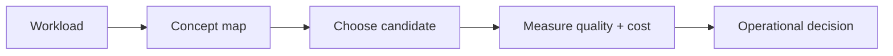

# Production engineering

> **TL;DR:** Follow the visual map, then open a focused note for the assumptions, measurement, and references.

**Figure 1: Simplified study path through this section.**

**Takeaway:** Move from the shared foundation to one method at a time, then validate with measurements.

| Topic | Use |
|---|---|
| [Capacity](01-capacity-planning-and-cost.md) | Start here for the decision summary and linked deep note. |
| [Ingestion](02-ingestion-pipelines-and-reindexing.md) | Start here for the decision summary and linked deep note. |
| [Tuning](03-tuning-playbook.md) | Start here for the decision summary and linked deep note. |
| [Observability](04-observability-and-failure-modes.md) | Start here for the decision summary and linked deep note. |
| [Tenancy and security](05-multi-tenancy-security.md) | Start here for the decision summary and linked deep note. |
| [RAG retrieval](06-rag-specific-retrieval.md) | Start here for the decision summary and linked deep note. |

**Start here:** [Capacity planning](01-capacity-planning-and-cost.md).

**Next:** [Vector databases master index](../00-INDEX.md).
