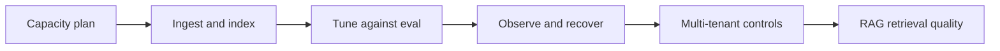

# Production Engineering

> [!TIP] **TL;DR:** Production ownership includes sizing, ingestion/rebuilds, tuning, observability, tenant isolation, and retrieval evaluation—not just index parameters. Planned notes are `todo`.

**Figure PE1.** Operational lifecycle.  
**Takeaway:** Changes to the embedding model, filters, or corpus distribution require revalidation.

| File | Focus | Status |
|---|---|---|
| [Capacity planning](01-capacity-planning-and-cost.md) | Memory / SSD / cost arithmetic | todo |
| [Ingestion and reindexing](02-ingestion-pipelines-and-reindexing.md) | Freshness and model migration | todo |
| [Tuning playbook](03-tuning-playbook.md) | Controlled parameter search | todo |
| [Observability and failure modes](04-observability-and-failure-modes.md) | Signals and response | todo |
| [Multi-tenancy and security](05-multi-tenancy-security.md) | Isolation and access controls | todo |
| [RAG retrieval](06-rag-specific-retrieval.md) | Retrieval in generation pipelines | todo |

**Start here:** [Capacity planning](01-capacity-planning-and-cost.md).

