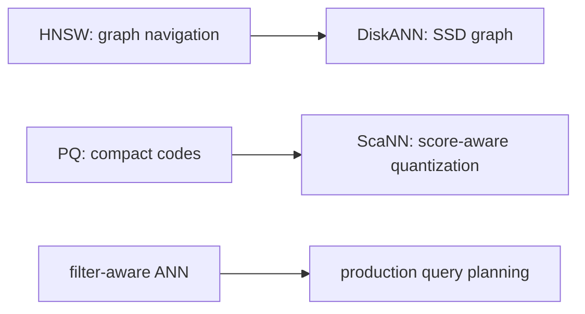

# Vector search paper index

> **TL;DR:** Read papers by the problem they solve: graph navigation, quantization, disk-resident search, filtering, and embedding representation.

**Figure 1: Simplified conceptual view of this topic.**

**Takeaway:** Follow the arrows to see where the method spends work and where the main trade-off enters.

### How to read this

- Follow arrows in the direction data or decisions move.
- The labels name the main components; they do not promise a specific implementation.
- Use the table and field notes below to connect the picture to measurements.

**Visual takeaway:** The diagram shows the main data or decision path; labels are conceptual, not performance guarantees.

## Field notes

A useful reading order is HNSW for hierarchical graph search, product quantization for compact codes, DiskANN for SSD-backed ANN, Filtered-DiskANN and ACORN for predicates, then Matryoshka for variable-dimension representations. Read abstracts and methods before importing benchmark claims; record dataset, hardware, metric, and baselines.

## Selected papers by system problem

**Selection rule (checked 2026-10-12):** include work that contributes a distinct index/representation/system, presents evaluated results, or materially changes deployment practice. This is a selected reading list, not an exhaustive literature survey. `Paper` links point to primary proceedings or author-hosted preprints; vendor implementation docs are labeled separately in the system notes.

| Problem | Paper | Contribution to look for |
|---|---|---|
| Candidate hashing | Indyk & Motwani, 1998, [STOC](https://doi.org/10.1145/276698.276876) | Locality-sensitive hashing gives probabilistic sublinear ANN guarantees under its assumptions. |
| Compact vectors | Jégou et al., 2011, [TPAMI](https://doi.org/10.1109/TPAMI.2010.57); Ge et al., 2013, [CVPR](https://openaccess.thecvf.com/content_cvpr_2013/html/Ge_Optimized_Product_Quantization_2013_CVPR_paper.html) | PQ codebooks and OPQ's learned rotation for more balanced subspaces. |
| Graph navigation | Malkov & Yashunin, 2018, [HNSW](https://arxiv.org/abs/1603.09320); Johnson et al., 2017, [FAISS](https://arxiv.org/abs/1702.08734) | Hierarchical proximity search and a reusable CPU/GPU ANN library. |
| Large and disk-backed ANN | Subramanya et al., 2019, [DiskANN](https://proceedings.neurips.cc/paper/2019/hash/09853c7fb1d3f8ee67a61b6bf4a7f8e6-Abstract.html); Singh et al., 2021, [FreshDiskANN preprint](https://arxiv.org/abs/2105.09613) | SSD-resident graph search and a streaming update path. FreshDiskANN's abstract reports a billion-point experiment; its hardware and workload are paper-specific. |
| Score-aware compression | Guo et al., 2020, [ScaNN / ICML](https://proceedings.mlr.press/v119/guo20h.html); Gao & Long, 2024, [RaBitQ preprint](https://arxiv.org/abs/2405.12497) | MIPS-aware residual quantization and a low-bit estimator with a theoretical error bound. |
| GPU graph search | Ootomo et al., 2024, [CAGRA / ICDE](https://doi.org/10.1109/ICDE60146.2024.00323); [cuVS CAGRA docs](https://docs.nvidia.com/cuvs/user-guide/api-guides/indexing-guide/cagra) | A graph build/search path designed for GPU parallelism; separate paper results from current library support and hardware-specific outcomes. |
| Partitioned and dynamic indexes | Chen et al., 2021, [SPANN / NeurIPS](https://proceedings.neurips.cc/paper_files/paper/2021/hash/299dc35e747eb77177d9cea10a802da2-Abstract.html); Xu et al., 2023, [SPFresh / SOSP](https://doi.org/10.1145/3600006.3613166); Mageirakos et al., 2025, [Cracking Vector Search Indexes / PVLDB](https://www.vldb.org/pvldb/vol18/p3951-mageirakos.pdf) | Partition-plus-posting-list search, incremental rebalancing, and progressively built adaptive IVF. The CrackIVF paper reports 10–100× faster initialization in its evaluated workloads; do not generalize that ratio to other hardware or data. |
| Filtered ANN | Gollapudi et al., 2023, [Filtered-DiskANN](https://doi.org/10.1145/3543507.3583552); Patel et al., 2024, [ACORN / SIGMOD](https://doi.org/10.1145/3654923); Chronis et al., 2025, [filtered-search survey / PVLDB](https://doi.org/10.14778/3750601.3750700) | Graph/index changes for predicates and a taxonomy of filtering, selectivity, and stable-recall challenges. |
| Multi-vector retrieval | Khattab & Zaharia, 2020, [ColBERT](https://arxiv.org/abs/2004.12832); Santhanam et al., 2022, [ColBERTv2](https://arxiv.org/abs/2112.01488) and [PLAID](https://arxiv.org/abs/2205.09707); Dhulipala et al., 2024, [MUVERA / NeurIPS](https://proceedings.neurips.cc/paper_files/paper/2024/hash/b71cfefae46909178603b5bc6c11d3ae-Abstract-Conference.html) | Late interaction, compressed token representations, and fixed-dimensional proxy search. MUVERA's paper reports its evaluation-specific recall and latency gains on BEIR; those results are not product guarantees. |
| Newer filtered and integrated designs | Wang et al., 2026, [WoW preprint](https://arxiv.org/abs/2508.18617), accepted at [SIGMOD 2026](https://2026.sigmod.org/sigmod_papers.shtml); Liu et al., 2026, [PostgreSQL-V / CIDR](https://www.cidrdb.org/cidr2026/papers/p2-liu.pdf); Li et al., 2025 preprint / [SIGMOD 2026 SAQ listing](https://2026.sigmod.org/sigmod_program_detailed.shtml) | Window-based incremental range-filtered search, decoupled relational/vector index architecture, and dimension-segmented quantization. WoW and SAQ are recent work; evaluate the paper artifacts and assumptions before adoption. |

## Sources

[HNSW paper](https://arxiv.org/abs/1603.09320) · [hnswlib](https://github.com/nmslib/hnswlib). Product behavior and defaults can vary by release; pin the version used in any benchmark.

**Next:** [Master index](../00-INDEX.md) · [Glossary](../99-glossary.md).
