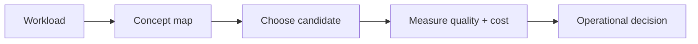

# Paper notes

> **TL;DR:** Follow the visual map, then open a focused note for the assumptions, measurement, and references.

**Figure 1: Simplified study path through this section.**

**Takeaway:** Move from the shared foundation to one method at a time, then validate with measurements.

| Topic | Use |
|---|---|
| [diskann-subramanya](diskann-subramanya.md) | Start here for the decision summary and linked deep note. |
| [filtered-diskann-gollapudi](filtered-diskann-gollapudi.md) | Start here for the decision summary and linked deep note. |
| [hnsw-malkov-yashunin](hnsw-malkov-yashunin.md) | Start here for the decision summary and linked deep note. |
| [product-quantization-jegou](product-quantization-jegou.md) | Start here for the decision summary and linked deep note. |

**Next:** [Vector databases master index](../../00-INDEX.md).
