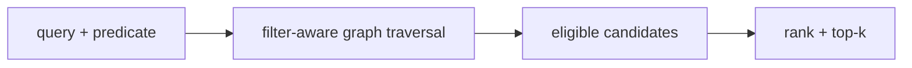

# Filtered-DiskANN paper note

> **TL;DR:** Filtered-DiskANN studies graph construction and query behavior when results must satisfy metadata predicates.

**Figure 1: Simplified conceptual view of this topic.**

**Takeaway:** Follow the arrows to see where the method spends work and where the main trade-off enters.

### How to read this

- Follow arrows in the direction data or decisions move.
- The labels name the main components; they do not promise a specific implementation.
- Use the table and field notes below to connect the picture to measurements.

**Visual takeaway:** The diagram shows the main data or decision path; labels are conceptual, not performance guarantees.

## Field notes

The paper targets the failure of applying arbitrary postfilters to an ANN result list: too few eligible records may survive, and graph connectivity can be problematic under predicates. Interpret reported gains in their tested workloads. In a system comparison, measure exact filtered ground truth, selectivity cohorts, and index/build overhead.

## Sources

[ACORN](https://arxiv.org/abs/2403.04871) · [Filtered-DiskANN](https://doi.org/10.1145/3543507.3583552). Product behavior and defaults can vary by release; pin the version used in any benchmark.

**Next:** [Master index](../../00-INDEX.md) · [Glossary](../../99-glossary.md).
