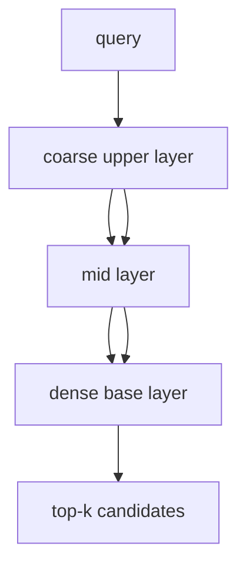

# HNSW paper note

> **TL;DR:** HNSW combines navigable small-world graphs with randomized hierarchy to support efficient approximate neighbor search.

**Figure 1: Simplified conceptual view of this topic.**

**Takeaway:** Follow the arrows to see where the method spends work and where the main trade-off enters.

### How to read this

- Follow arrows in the direction data or decisions move.
- The labels name the main components; they do not promise a specific implementation.
- Use the table and field notes below to connect the picture to measurements.

**Visual takeaway:** The diagram shows the main data or decision path; labels are conceptual, not performance guarantees.

## Field notes

The paper contributes a hierarchical graph construction and greedy descent/search strategy. The hierarchy gives long-range routing at upper levels and local refinement at the base. Practical behavior depends on graph degree, construction candidate breadth, search breadth, metric, and memory. The algorithm is not a guarantee of a particular recall or latency.

## Sources

[HNSW paper](https://arxiv.org/abs/1603.09320) · [hnswlib](https://github.com/nmslib/hnswlib). Product behavior and defaults can vary by release; pin the version used in any benchmark.

**Next:** [Master index](../../00-INDEX.md) · [Glossary](../../99-glossary.md).
