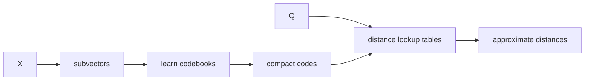

# Product quantization paper note

> **TL;DR:** Product quantization compresses vectors by independently quantizing subvectors, enabling compact codes and efficient approximate distance computation.

**Figure 1: Simplified conceptual view of this topic.**

**Takeaway:** Follow the arrows to see where the method spends work and where the main trade-off enters.

### How to read this

- Follow arrows in the direction data or decisions move.
- The labels name the main components; they do not promise a specific implementation.
- Use the table and field notes below to connect the picture to measurements.

**Visual takeaway:** The diagram shows the main data or decision path; labels are conceptual, not performance guarantees.

## Field notes

The core insight is decomposing a high-dimensional space into lower-dimensional subspaces whose codebooks can be combined. ADC compares an uncompressed query to encoded database vectors via precomputed tables. Distortion, subspace correlation, training sample representativeness, and reranking policy determine practical quality.

## Sources

[Product quantization paper](https://doi.org/10.1109/TPAMI.2010.57) · [FAISS index guide](https://github.com/facebookresearch/faiss/wiki/Faiss-indexes). Product behavior and defaults can vary by release; pin the version used in any benchmark.

**Next:** [Master index](../../00-INDEX.md) · [Glossary](../../99-glossary.md).
