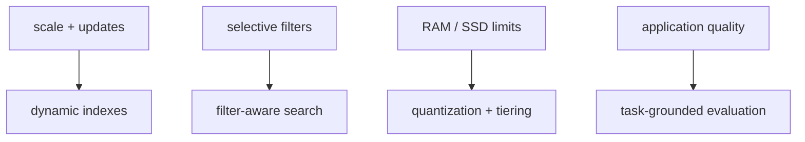

# Open problems and research directions

> **TL;DR:** Active systems problems include filtered ANN, dynamic updates, disk locality, compressed-distance accuracy, and evaluation that reflects application relevance.

**Figure 1: Simplified conceptual view of this topic.**

**Takeaway:** Follow the arrows to see where the method spends work and where the main trade-off enters.

### How to read this

- Follow arrows in the direction data or decisions move.
- The labels name the main components; they do not promise a specific implementation.
- Use the table and field notes below to connect the picture to measurements.

**Visual takeaway:** The diagram shows the main data or decision path; labels are conceptual, not performance guarantees.

## Field notes

Research snapshot (2026-10-12):

| Direction | Recent evidence | Engineering question |
|---|---|---|
| Filtered search with stable recall | A 2025 [PVLDB tutorial](https://doi.org/10.14778/3750601.3750700) identifies selectivity, correlation, and stable recall as central design concerns. [WoW](https://arxiv.org/abs/2508.18617), accepted at [SIGMOD 2026](https://2026.sigmod.org/sigmod_papers.shtml), studies incremental range-filtered search. | Can the system meet a target recall across rare filters without duplicating an index per predicate? What is the cost of filter-aware updates? |
| Indexes that learn while serving | [CrackIVF](https://www.vldb.org/pvldb/vol18/p3951-mageirakos.pdf) proposes an adaptive partition index that answers queries before conventional full index construction completes. Its 10–100× faster initialization claim is from the authors' evaluated workloads. | Does query-driven refinement match the production query distribution, and what happens when that distribution shifts? |
| Relational/vector engine boundaries | [PostgreSQL-V (CIDR 2026)](https://www.cidrdb.org/cidr2026/papers/p2-liu.pdf) studies decoupling vector indexes from PostgreSQL's page-oriented engine and adding a consistency mechanism. This is a research system, not a claim about PostgreSQL core or pgvector. | How do independent index storage, transactions, WAL/recovery, and replicas preserve consistency? |
| Representation and quantization | [SAQ](https://arxiv.org/abs/2509.12086), listed in the [SIGMOD 2026 program](https://2026.sigmod.org/sigmod_program_detailed.shtml), explores code adjustment and dimension segmentation. [MUVERA](https://proceedings.neurips.cc/paper_files/paper/2024/hash/b71cfefae46909178603b5bc6c11d3ae-Abstract-Conference.html) targets multi-vector-to-single-vector candidate search. | Which quality measure does the quantizer optimize, and does the gain survive filtered, end-to-end relevance evaluation? |

These papers were selected because they study distinct indexing, representation, or consistency mechanisms and provide evaluated work or a peer-reviewed venue. Treat paper results as workload-specific. Compare methods on the same corpus, filters, quality target, hardware, and update workload; published wins do not establish product guarantees.

## Sources

[Filtered-search tutorial](https://doi.org/10.14778/3750601.3750700) · [WoW paper](https://arxiv.org/abs/2508.18617) · [CrackIVF paper](https://www.vldb.org/pvldb/vol18/p3951-mageirakos.pdf) · [PostgreSQL-V paper](https://www.cidrdb.org/cidr2026/papers/p2-liu.pdf) · [SAQ preprint](https://arxiv.org/abs/2509.12086). Product behavior and defaults can vary by release; pin the version used in any benchmark.

**Next:** [Master index](../00-INDEX.md) · [Glossary](../99-glossary.md).
