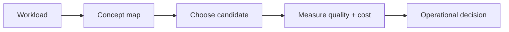

# Research notes

> **TL;DR:** Follow the visual map, then open a focused note for the assumptions, measurement, and references.

**Figure 1: Simplified study path through this section.**

**Takeaway:** Move from the shared foundation to one method at a time, then validate with measurements.

| Topic | Use |
|---|---|
| [Paper index](01-paper-index.md) | Start here for the decision summary and linked deep note. |
| [Open questions](03-open-problems-and-trends.md) | Start here for the decision summary and linked deep note. |

**Start here:** [Paper index](01-paper-index.md).

**Next:** [Vector databases master index](../00-INDEX.md).
