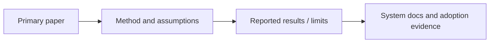

# Research

> [!TIP] **TL;DR:** Paper notes separate a paper's actual method and reported evaluation from vendor implementation claims and later adoption. Planned research notes are `todo`.

**Figure R1.** Evidence path for a paper note.  
**Takeaway:** Cite the primary source for a research claim and product documentation for shipped behavior.

| File | Focus | Status |
|---|---|---|
| [Paper index](01-paper-index.md) | Bibliography and research lineage | todo |
| [Paper notes](02-paper-notes/) | Notes per selected primary paper | todo |
| [Open problems and trends](03-open-problems-and-trends.md) | Bounded, cited 2024–2026 scan | todo |

**Start here:** [Paper index](01-paper-index.md).

