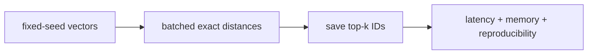

# Brute-force kNN lab

> **TL;DR:** Build an exact NumPy baseline first; it anchors recall measurement for every approximate index.



**Visual takeaway:** The diagram shows the main data or decision path; labels are conceptual, not performance guarantees.

## Field notes

Run: `python -m pip install numpy` then create normalized random vectors and queries with a fixed seed. Compute cosine scores in query batches using matrix multiplication; use `argpartition` for candidate selection and sort the selected k. Record vector count, dimension, dtype, batch size, and elapsed time. Compare approximate outputs by ID overlap, not rounded scores.

## Run this experiment

The data source is the public [MNIST dataset](https://ann-benchmarks.com/), downloaded from the [dataset mirror](https://storage.googleapis.com/cvdf-datasets/mnist/). The runner uses a fixed prefix of train images and test images, flattens 28×28 pixels to 784 dimensions, and L2-normalizes vectors for cosine ranking. This is a small reproducible teaching workload, not a production benchmark.

**Experiment:** The exact scan is the recall@10=1.0 ground-truth baseline. It reports serial query latency and vector bytes.

```powershell
python ../runner.py --rows 2000 --queries 50 --methods flat
```

Measured output and the generated [CSV](../results/results.csv) and [recall/QPS plot](../results/recall-vs-qps.svg) are shared across the runnable labs. Values are machine-specific; see the parent [lab results table](../README.md).

