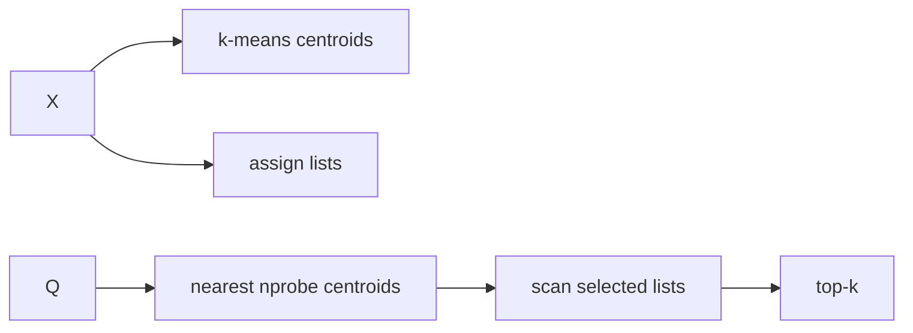

# IVF from scratch lab

> **TL;DR:** Train a coarse k-means quantizer, assign database vectors to lists, and search only the closest probed lists.



**Visual takeaway:** The diagram shows the main data or decision path; labels are conceptual, not performance guarantees.

## Field notes

Using NumPy and a fixed seed, implement Lloyd iterations on a small synthetic corpus, bucket row IDs by nearest centroid, and query increasing nprobe values. Compare recall against exact top-k. Keep centroid training, assignment, and scan timings separate; this educational implementation is not a production ANN benchmark.

## Run this experiment

The data source is the public [MNIST dataset](https://ann-benchmarks.com/), downloaded from the [dataset mirror](https://storage.googleapis.com/cvdf-datasets/mnist/). The runner uses a fixed prefix of train images and test images, flattens 28×28 pixels to 784 dimensions, and L2-normalizes vectors for cosine ranking. This is a small reproducible teaching workload, not a production benchmark.

**Experiment:** The NumPy implementation trains 32 coarse centroids, builds lists, and sweeps nprobe 2, 8, and 16.

```powershell
python ../runner.py --rows 2000 --queries 50 --methods ivf
```

Measured output and the generated [CSV](../results/results.csv) and [recall/QPS plot](../results/recall-vs-qps.svg) are shared across the runnable labs. Values are machine-specific; see the parent [lab results table](../README.md).

