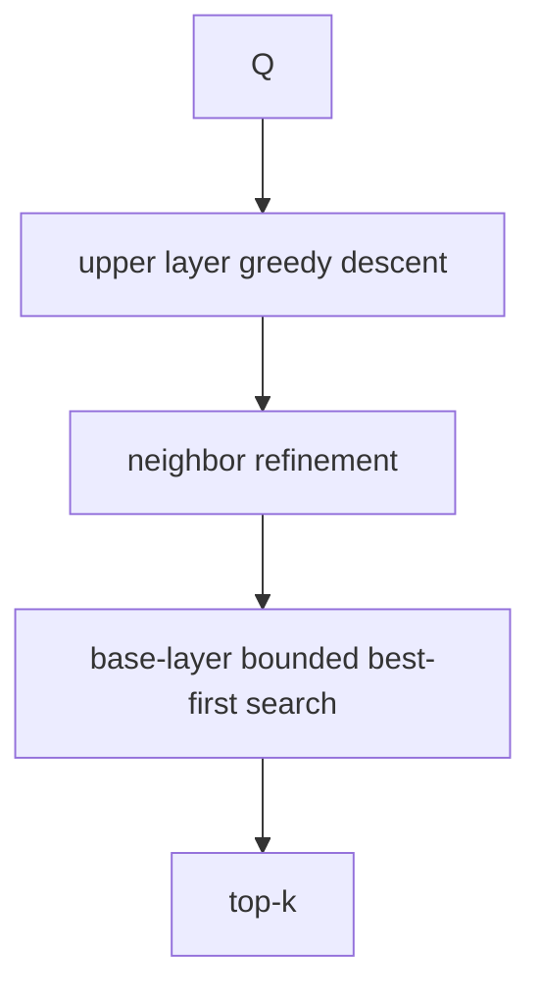

# Tiny HNSW lab

> **TL;DR:** Trace hierarchical greedy routing on a small graph to understand why a coarse-to-fine search can reduce examined nodes.



**Visual takeaway:** The diagram shows the main data or decision path; labels are conceptual, not performance guarantees.

## Field notes

Implementing production HNSW correctly is beyond a short exercise; use a maintained library for real indexes. For learning, build a tiny deterministic layered graph, count distance evaluations during greedy descent, and compare its result with exact search. Vary graph degree and search breadth, then plot recall against distance evaluations.

## Run this experiment

The data source is the public [MNIST dataset](https://ann-benchmarks.com/), downloaded from the [dataset mirror](https://storage.googleapis.com/cvdf-datasets/mnist/). The runner uses a fixed prefix of train images and test images, flattens 28×28 pixels to 784 dimensions, and L2-normalizes vectors for cosine ranking. This is a small reproducible teaching workload, not a production benchmark.

**Experiment:** The Python implementation builds a small layered graph with M=8 and reports recall, latency, build time, and an adjacency-memory estimate.

```powershell
python tiny_hnsw.py
```

Measured output and the generated [CSV](../results/results.csv) and [recall/QPS plot](../results/recall-vs-qps.svg) are shared across the runnable labs. Values are machine-specific; see the parent [lab results table](../README.md).

