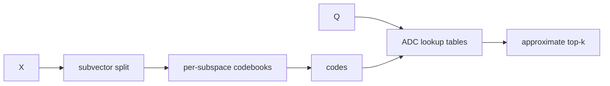

# PQ from scratch lab

> **TL;DR:** Train one small k-means codebook per subspace, encode vectors, and use ADC lookup tables to estimate query distances.



**Visual takeaway:** The diagram shows the main data or decision path; labels are conceptual, not performance guarantees.

## Field notes

Use a fixed-seed low-dimensional dataset with a dimension divisible by the number of subspaces. Report code bytes/vector and recall versus exact search. Include codebook storage in total memory. Compare ADC to reconstructed-vector distances to see why query-to-centroid lookup can preserve ranking better than comparing two quantized vectors.

## Run this experiment

The data source is the public [MNIST dataset](https://ann-benchmarks.com/), downloaded from the [dataset mirror](https://storage.googleapis.com/cvdf-datasets/mnist/). The runner uses a fixed prefix of train images and test images, flattens 28×28 pixels to 784 dimensions, and L2-normalizes vectors for cosine ranking. This is a small reproducible teaching workload, not a production benchmark.

**Experiment:** The NumPy implementation uses 16 subspaces and 32 centroids per subspace; its code is 16 bytes/vector, excluding codebooks.

```powershell
python ../runner.py --rows 2000 --queries 50 --methods pq
```

Measured output and the generated [CSV](../results/results.csv) and [recall/QPS plot](../results/recall-vs-qps.svg) are shared across the runnable labs. Values are machine-specific; see the parent [lab results table](../README.md).

