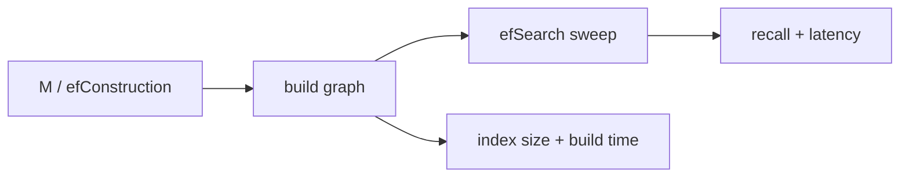

# hnswlib parameter sweep lab

> **TL;DR:** Measure how construction and query breadth alter recall, build time, memory, and latency for a pinned hnswlib build.



**Visual takeaway:** The diagram shows the main data or decision path; labels are conceptual, not performance guarantees.

## Field notes

Pin hnswlib and NumPy versions and use a fixed public dataset/query split. Set query `ef` at least to k. Keep thread count, metric, insertion order, and warm-up fixed. Report the parameter grid and raw results; do not summarize one run as a universal best setting.

## Run this experiment

The data source is the public [MNIST dataset](https://ann-benchmarks.com/), downloaded from the [dataset mirror](https://storage.googleapis.com/cvdf-datasets/mnist/). The runner uses a fixed prefix of train images and test images, flattens 28×28 pixels to 784 dimensions, and L2-normalizes vectors for cosine ranking. This is a small reproducible teaching workload, not a production benchmark.

**Experiment:** The script sweeps M=16/32 and ef=20/50/100. Install the separate pinned requirements first.

```powershell
python hnswlib_sweep.py
```

Install with `python -m pip install -r ../requirements-hnswlib.txt`. **Execution status:** not run in this Windows session; building pinned `hnswlib==0.8.0` stopped because Microsoft C++ Build Tools 14.0+ are not installed. The script is included and this limitation is recorded rather than substituting invented results.

