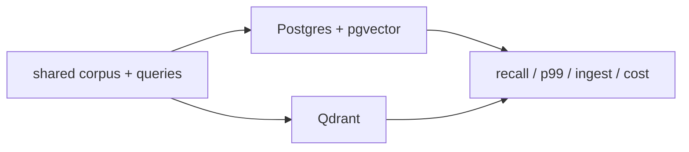

# pgvector versus Qdrant lab

> **TL;DR:** Compare systems only after matching vectors, metric, top-k, filters, hardware, concurrency, and durability expectations.



**Visual takeaway:** The diagram shows the main data or decision path; labels are conceptual, not performance guarantees.

## Field notes

Pin server and extension versions, schemas, index parameters, and container resources. Compute exact ground truth once and apply equivalent tenant filters. Record ingestion, build, update, restart/recovery, index size, result count, and latency under a fixed load. Explain unavoidable semantic differences rather than claiming a pure apples-to-apples result.

## Run this experiment

The data source is the public [MNIST dataset](https://ann-benchmarks.com/), downloaded from the [dataset mirror](https://storage.googleapis.com/cvdf-datasets/mnist/). The runner uses a fixed prefix of train images and test images, flattens 28×28 pixels to 784 dimensions, and L2-normalizes vectors for cosine ranking. This is a small reproducible teaching workload, not a production benchmark.

**Experiment:** This experiment requires PostgreSQL with pgvector and Qdrant services. It was not run here because Docker is unavailable; no system comparison numbers are claimed.

```powershell
See the matched-workload procedure in this note.
```

**Execution status:** not run in this session: Docker is unavailable, so no PostgreSQL/pgvector or Qdrant server could be started. The valid comparison protocol must use the same corpus, metric, filter predicates, top-k, hardware limits, and exact ground truth on both systems.

