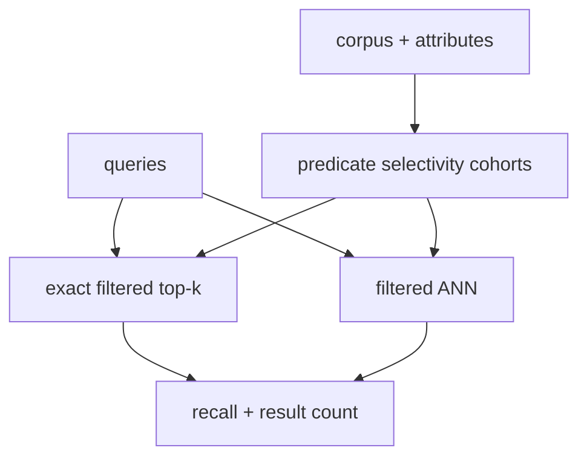

# Filtered-search recall lab

> **TL;DR:** Measure recall against exact top-k within each predicate cohort; unfiltered recall does not characterize filtered search.



**Visual takeaway:** The diagram shows the main data or decision path; labels are conceptual, not performance guarantees.

## Field notes

Generate or select a dataset with known categorical metadata and create broad, medium, and selective predicates. For each query/predicate pair, brute-force only eligible rows for ground truth. Sweep filter strategy and oversampling, reporting recall, underfilled-result rate, latency, and eligible row count. Fix predicate semantics identically across paths.

## Run this experiment

The data source is the public [MNIST dataset](https://ann-benchmarks.com/), downloaded from the [dataset mirror](https://storage.googleapis.com/cvdf-datasets/mnist/). The runner uses a fixed prefix of train images and test images, flattens 28×28 pixels to 784 dimensions, and L2-normalizes vectors for cosine ranking. This is a small reproducible teaching workload, not a production benchmark.

**Experiment:** Synthetic 20-way tenant labels are applied to the public MNIST vector prefix. Exact top-10 is computed within each eligible set; postfilter depth is swept.

```powershell
python ../runner.py --rows 2000 --queries 50 --methods filtered
```

Measured output and the generated [CSV](../results/results.csv) and [recall/QPS plot](../results/recall-vs-qps.svg) are shared across the runnable labs. Values are machine-specific; see the parent [lab results table](../README.md).

