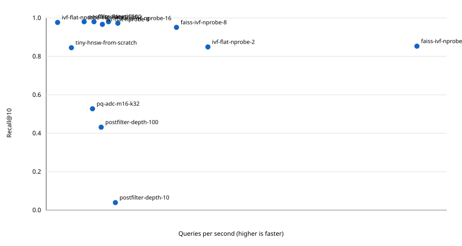

# Hands-on labs

> **TL;DR:** Follow the visual map, then open a focused note for the assumptions, measurement, and references.

**Figure 1: Simplified study path through this section.**

**Takeaway:** Move from the shared foundation to one method at a time, then validate with measurements.

| Topic | Use |
|---|---|
| [01-brute-force-knn](01-brute-force-knn/README.md) | Start here for the decision summary and linked deep note. |
| [02-ivf-from-scratch](02-ivf-from-scratch/README.md) | Start here for the decision summary and linked deep note. |
| [03-tiny-hnsw-from-scratch](03-tiny-hnsw-from-scratch/README.md) | Start here for the decision summary and linked deep note. |
| [04-pq-from-scratch](04-pq-from-scratch/README.md) | Start here for the decision summary and linked deep note. |
| [05-faiss-sweep](05-faiss-sweep/README.md) | Start here for the decision summary and linked deep note. |
| [06-hnswlib-param-sweep](06-hnswlib-param-sweep/README.md) | Start here for the decision summary and linked deep note. |
| [07-pgvector-vs-qdrant](07-pgvector-vs-qdrant/README.md) | Start here for the decision summary and linked deep note. |
| [08-filtered-search-recall](08-filtered-search-recall/README.md) | Start here for the decision summary and linked deep note. |

**Start here:** [Brute-force kNN lab](01-brute-force-knn/README.md).

**Next:** [Vector databases master index](../00-INDEX.md).

## Reproducible run

The runner downloads public MNIST train/test image vectors, takes the first 2,000 training rows and 50 test queries, flattens 28×28 pixels to 784 dimensions, and L2-normalizes them for cosine ranking. Dependencies are pinned in [requirements.txt](requirements.txt). The following serial single-query run was executed in this workspace; QPS and latency are machine- and process-specific, and estimated index bytes omit process/runtime overhead.

**Metric note:** ANN-Benchmarks lists MNIST with Euclidean distance. This educational run deliberately normalizes pixel vectors and uses cosine similarity instead, so its measurements should not be compared directly with published MNIST leaderboard results. See the [dataset listing](https://ann-benchmarks.com/).

| Method | Recall@10 | QPS | p95 ms | Estimated index bytes |
|---|---:|---:|---:|---:|
| exact-flat | 1.000 | 1627 | 0.730 | 6,272,000 |
| ivf-flat-nprobe-2 | 0.866 | 4224 | 0.368 | 6,388,352 |
| ivf-flat-nprobe-8 | 0.986 | 1468 | 0.920 | 6,388,352 |
| ivf-flat-nprobe-16 | 0.996 | 298 | 4.130 | 6,388,352 |
| pq-adc-m16-k32 | 0.538 | 1209 | 1.087 | 132,352 |
| faiss-flat | 1.000 | 1248 | 0.960 | 6,272,045 |
| faiss-ivf-nprobe-2 | 0.870 | 9685 | 0.152 | 6,388,747 |
| faiss-ivf-nprobe-8 | 0.970 | 3404 | 0.357 | 6,388,747 |
| faiss-ivf-nprobe-16 | 0.992 | 1873 | 0.681 | 6,388,747 |
| postfilter-depth-10 (filtered) | 0.040; underfill 50 / 50 | 1807 | 0.681 | 6,272,000 |
| postfilter-depth-100 (filtered) | 0.440; underfill 48 / 50 | 1436 | 0.845 | 6,272,000 |
| postfilter-depth-500 (filtered) | 1.000; underfill 0 / 50 | 991 | 1.285 | 6,272,000 |
| tiny-hnsw-from-scratch | 0.862 | 658 | 2.138 | 6,344,776 |

The plot includes the exact baseline, NumPy IVF/PQ, FAISS Flat/IVF, the toy HNSW implementation, and postfilter-depth settings. Filtered rows have their own exact eligible-set ground truth. The `hnswlib` sweep and PostgreSQL/Qdrant comparison are documented but not run in this session because the required compiler and database services are unavailable.

**Reproduce:** from this directory, run `python -m pip install -r requirements.txt`, then `python runner.py --rows 2000 --queries 50 --methods flat,ivf,pq,faiss,filtered`; run the toy graph separately with `python 03-tiny-hnsw-from-scratch/tiny_hnsw.py`.
