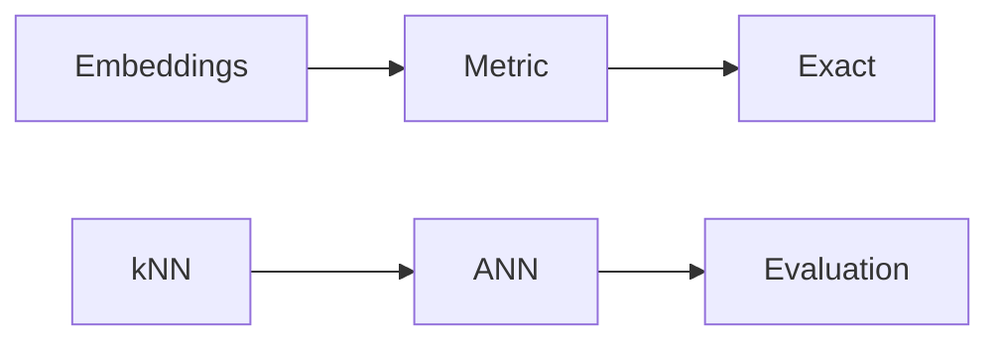

# Fundamentals Q&A

> **TL;DR:** Strong answers define the metric, baseline, and workload before naming an index.

**Visual takeaway:** The diagram shows the main data or decision path; labels are conceptual, not performance guarantees.

## At a glance

| Question | Practical answer |
|---|---|
| What to measure | Quality against an exact or judged baseline, latency percentiles, resource use |
| Main trade-off | Search work and representation cost versus recall, freshness, and complexity |
| First diagnostic | Hold the data, metric, filters, and query set fixed; change one variable |

## Field notes

**Why normalize?** It makes dot product equal cosine similarity for nonzero unit vectors. **What is recall@k?** The fraction of exact top-k IDs recovered by the approximate result. **Why ANN?** It reduces query work at a controllable quality cost. **When use brute force?** Small corpora, GPU-friendly batches, exactness, or as ground truth. **Is a vector DB just an index?** No: production systems also handle metadata, persistence, updates, filtering, and distribution.

## Sources

[ANN survey](https://arxiv.org/abs/1806.09823) · [FAISS paper](https://arxiv.org/abs/1702.08734). Product behavior and defaults can vary by release; pin the version used in any benchmark.

**Next:** [Master index](../00-INDEX.md) · [Glossary](../99-glossary.md).
