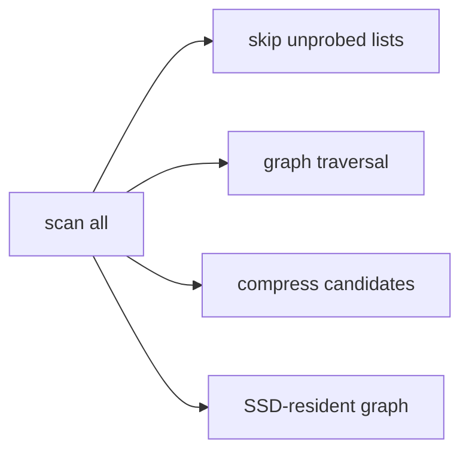

# Algorithms Q&A

> **TL;DR:** Explain what work an index skips and what parameter restores when recall drops.

**Visual takeaway:** The diagram shows the main data or decision path; labels are conceptual, not performance guarantees.

## At a glance

| Question | Practical answer |
|---|---|
| What to measure | Quality against an exact or judged baseline, latency percentiles, resource use |
| Main trade-off | Search work and representation cost versus recall, freshness, and complexity |
| First diagnostic | Hold the data, metric, filters, and query set fixed; change one variable |

## Field notes

**IVF vs HNSW?** Coarse list scans versus graph navigation; workload and memory determine the trade-off. **What does nprobe do?** Increases the number of IVF lists searched. **What does efSearch do?** Broadens HNSW query exploration. **Why PQ?** Reduce vector storage and distance cost with quantization error. **Why rerank?** Restore accurate ordering for a small candidate set using original vectors.

## Sources

[ANN survey](https://arxiv.org/abs/1806.09823) · [FAISS paper](https://arxiv.org/abs/1702.08734). Product behavior and defaults can vary by release; pin the version used in any benchmark.

**Next:** [Master index](../00-INDEX.md) · [Glossary](../99-glossary.md).
