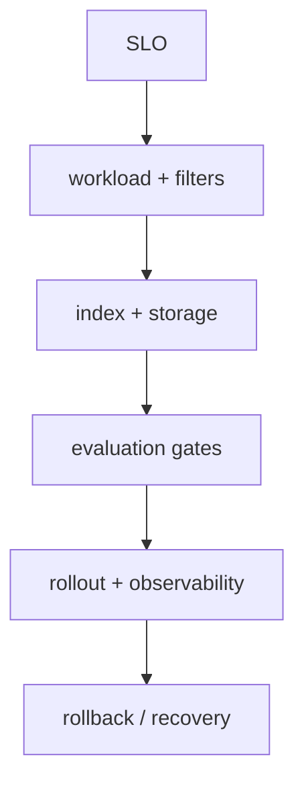

# System design Q&A

> **TL;DR:** Design from SLOs and data lifecycle: exact baseline, index family, metadata, update path, evaluation, and recovery.

**Visual takeaway:** The diagram shows the main data or decision path; labels are conceptual, not performance guarantees.

## At a glance

| Question | Practical answer |
|---|---|
| What to measure | Quality against an exact or judged baseline, latency percentiles, resource use |
| Main trade-off | Search work and representation cost versus recall, freshness, and complexity |
| First diagnostic | Hold the data, metric, filters, and query set fixed; change one variable |

## Field notes

For 100M vectors, estimate raw bytes first and multiply by replicas and measured index overhead. Separate ingestion from query serving; version embeddings and indexes for migrations. Enforce tenant scope at the server boundary. Define durability acknowledgment, backup/restore, freshness, and partial-shard behavior. Use a benchmark that includes selective filters and p99, not just aggregate QPS.

## Sources

[ANN survey](https://arxiv.org/abs/1806.09823) · [FAISS paper](https://arxiv.org/abs/1702.08734). Product behavior and defaults can vary by release; pin the version used in any benchmark.

**Next:** [Master index](../00-INDEX.md) · [Glossary](../99-glossary.md).
