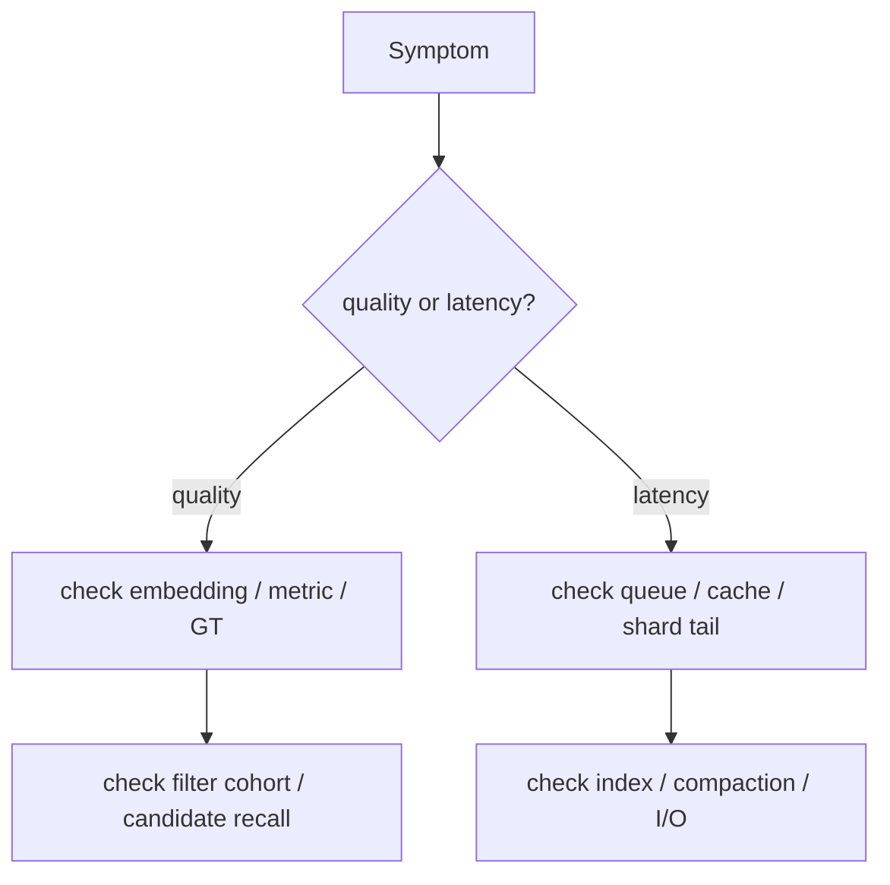

# Retrieval debugging scenarios

> **TL;DR:** Diagnose by splitting relevance, filtering, freshness, and serving latency before changing index knobs.

**Visual takeaway:** The diagram shows the main data or decision path; labels are conceptual, not performance guarantees.

## At a glance

| Question | Practical answer |
|---|---|
| What to measure | Quality against an exact or judged baseline, latency percentiles, resource use |
| Main trade-off | Search work and representation cost versus recall, freshness, and complexity |
| First diagnostic | Hold the data, metric, filters, and query set fixed; change one variable |

## Field notes

**Recall fell after deploy:** compare model/preprocessing versions, metric, corpus coverage, and index build parameters against a frozen query set. **Filtered results underfill:** compare eligible-set size and exact filtered top-k, then test oversampling or filter-aware search. **p99 spikes:** break down queue, shard, page fault, and merge time; correlate with compaction and cold cache. **Stale results:** trace ingestion checkpoints and replica freshness.

## Sources

[ANN-Benchmarks](https://ann-benchmarks.com/) · [Big ANN benchmarks](https://big-ann-benchmarks.com/). Product behavior and defaults can vary by release; pin the version used in any benchmark.

**Next:** [Master index](../00-INDEX.md) · [Glossary](../99-glossary.md).
