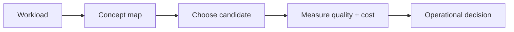

# Interview bank

> **TL;DR:** Follow the visual map, then open a focused note for the assumptions, measurement, and references.

**Figure 1: Simplified study path through this section.**

**Takeaway:** Move from the shared foundation to one method at a time, then validate with measurements.

| Topic | Use |
|---|---|
| [01-fundamentals-qa.md](01-fundamentals-qa.md) | Start here for the decision summary and linked deep note. |
| [02-algorithms-qa.md](02-algorithms-qa.md) | Start here for the decision summary and linked deep note. |
| [03-system-design-qa.md](03-system-design-qa.md) | Start here for the decision summary and linked deep note. |
| [04-debugging-scenarios.md](04-debugging-scenarios.md) | Start here for the decision summary and linked deep note. |
| [05-tricky-corner-cases.md](05-tricky-corner-cases.md) | Start here for the decision summary and linked deep note. |
| [06-rapid-fire-100.md](06-rapid-fire-100.md) | Start here for the decision summary and linked deep note. |

**Start here:** [Fundamentals Q&A](01-fundamentals-qa.md).

**Next:** [Vector databases master index](../00-INDEX.md).
