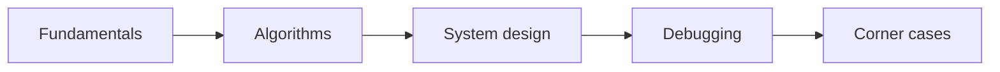

# Interview Bank

> [!TIP] **TL;DR:** Answers should start with a crisp, accurate 30-second response and then explain assumptions, math, trade-offs, and operational consequences. Planned Q&A is `todo`.

**Figure IB1.** Interview progression.  
**Takeaway:** Strong answers explain when a claim stops being true.

| File | Focus | Status |
|---|---|---|
| [Fundamentals Q&A](01-fundamentals-qa.md) | Embeddings and search basics | todo |
| [Algorithms Q&A](02-algorithms-qa.md) | Index trade-offs | todo |
| [System design Q&A](03-system-design-qa.md) | Architecture and sizing | todo |
| [Debugging scenarios](04-debugging-scenarios.md) | Production incidents | todo |
| [Tricky corner cases](05-tricky-corner-cases.md) | Assumptions and traps | todo |
| [Rapid-fire 100](06-rapid-fire-100.md) | Short recall practice | todo |

**Start here:** [Fundamentals Q&A](01-fundamentals-qa.md).

