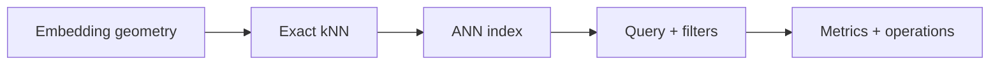

# Glossary

**Figure 1: Simplified relationship between retrieval terms.**

**Takeaway:** Model geometry and exact retrieval define the terms used to discuss ANN and operations.

Definitions here are deliberately compact. Product-specific meanings must be checked against the cited product version.

| Term | Definition | Reference |
|---|---|---|
| ANN / ANNS | Approximate nearest-neighbor search: return neighbors close to the exact top-k while reducing query cost; quality is measured against an exact ground truth. | [ANN-Benchmarks](https://ann-benchmarks.com/) |
| ADC | Asymmetric distance computation: compare a full-precision query to a quantized database vector using lookup tables. | [Jégou et al.](https://doi.org/10.1109/TPAMI.2010.57) |
| efConstruction | HNSW build-time search breadth used while inserting a point; higher values generally trade more build work/memory for graph quality. Exact semantics are implementation-specific. | [HNSW paper](https://arxiv.org/abs/1603.09320) |
| efSearch | HNSW query-time candidate/search breadth; implementation-specific, often a recall/latency knob. | [HNSW paper](https://arxiv.org/abs/1603.09320) |
| Embedding | A learned numeric representation of an input (text, image, etc.); similarity reflects the training objective and model, not universal semantic truth. | [Sentence-BERT](https://arxiv.org/abs/1908.10084) |
| Exact kNN | Return the true k nearest records under the chosen metric and eligible-set predicate. A full scan costs Θ(Nd) arithmetic for N vectors of dimension d. | [FAISS paper](https://arxiv.org/abs/1702.08734) |
| HNSW | Hierarchical Navigable Small World: multi-layer proximity graph for approximate search. Its observed scaling is workload and implementation dependent, not a general worst-case guarantee. | [Malkov & Yashunin](https://arxiv.org/abs/1603.09320) |
| IVF | Inverted file: partition vectors into coarse cells and scan selected inverted lists at query time. | [FAISS indexes](https://github.com/facebookresearch/faiss/wiki/Faiss-indexes) |
| kNN / top-k | k nearest neighbors / the k highest-ranked candidates under a specified score and eligibility rule. | [FAISS paper](https://arxiv.org/abs/1702.08734) |
| L2 / Euclidean distance | `||x-y||â‚‚`; smaller is closer. Squared L2 preserves ranking and avoids square roots. | [FAISS metric notes](https://github.com/facebookresearch/faiss/wiki/MetricType-and-distances) |
| M (HNSW) | Maximum-neighbor parameter used by many HNSW implementations. Layer-0 and upper-layer degree rules vary; don't apply one implementation's memory formula blindly. | [HNSW paper](https://arxiv.org/abs/1603.09320) |
| MIPS / inner product | Maximum inner-product search ranks by `q·x`; it is not equivalent to cosine unless vector norms are controlled. | [ScaNN paper](https://proceedings.mlr.press/v119/guo20h.html) |
| nlist / nprobe | IVF coarse-list count / number of lists selected for a query. `nprobe` is typically bounded by `nlist`; effective work also depends on list balance. | [FAISS indexes](https://github.com/facebookresearch/faiss/wiki/Faiss-indexes) |
| Object storage | Remote durable object/file store (e.g., S3-compatible APIs); request latency and access granularity matter for index designs. It is not equivalent to local SSD. | [Milvus architecture](https://milvus.io/docs/architecture_overview.md) |
| OPQ | Optimized Product Quantization: jointly optimize space decomposition and codebooks to reduce quantization distortion. | [Ge et al., CVPR 2013](https://openaccess.thecvf.com/content_cvpr_2013/html/Ge_Optimized_Product_Quantization_2013_CVPR_paper.html) |
| PQ | Product Quantization: split a vector into subvectors and encode each with a codebook index; approximate distance can be table-driven. | [Jégou et al.](https://doi.org/10.1109/TPAMI.2010.57) |
| Recall@k | `|approx_top_k ∩ exact_top_k| / k` for a query; aggregation (mean, percentile, workload weighting) must be stated. | [ANN-Benchmarks](https://ann-benchmarks.com/) |
| RRF | Reciprocal Rank Fusion combines ranked lists using `Σ 1/(c + rank)`; original paper is Cormack, Clarke & Büttcher (SIGIR 2009). | [DOI](https://doi.org/10.1145/1571941.1572114) |
| Segment | A storage/index unit in some engines. Mutability, lifecycle, and compaction are product-specific. | [Milvus data processing](https://milvus.io/docs/data_processing.md) |
| Selectivity | Fraction of records satisfying a predicate; low selectivity means few eligible records. State whether measured per shard, partition, or corpus. | [Filtered-DiskANN](https://doi.org/10.1145/3543507.3583552) |
| Shard | A partition of data/work used for routing and parallel execution; partitioning semantics vary by product. | [Milvus architecture](https://milvus.io/docs/architecture_overview.md) |
| SQ | Scalar quantization: encode each scalar component with fewer bits than its original representation; error and supported formats are implementation-specific. | [FAISS indexes](https://github.com/facebookresearch/faiss/wiki/Faiss-indexes) |
| Tombstone | Marker that hides a deleted record pending physical reclamation/compaction. Whether and how it applies depends on the storage engine. | [Milvus data processing](https://milvus.io/docs/data_processing.md) |
| WAL | Write-ahead log: record mutations before acknowledging/publishing according to the system's durability contract; exact guarantees vary. | [Milvus architecture](https://milvus.io/docs/architecture_overview.md) |

## Scope note

Definitions state the general concept. For product-specific parameter semantics, use the versioned official documentation linked by the relevant module.

**Next:** [Master index](00-INDEX.md).  
**Related:** [Diagram legend](assets/legend.md), [research index](09-research/01-paper-index.md).

