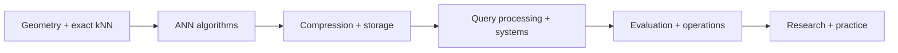

# Vector Databases

Field notes on similarity search, ANN indexes, vector storage, distributed retrieval, evaluation, and production operation. Start with the [master index](00-INDEX.md) for six grouped study passes, concept dependencies, and question lookup.

**Figure 1: Simplified learning path across the collection.**

**Takeaway:** Learn the metric and baseline first; add approximation, system behavior, and production evidence in that order.

**Status:** concise, visual-first field notes with linked sources. Benchmarks are reproducible procedures; no unrun results are presented as measured facts.

## Start here

- [Master index](00-INDEX.md)
- [Glossary](99-glossary.md)
- [Diagram legend](assets/legend.md)
- [Hero diagrams](assets/)

