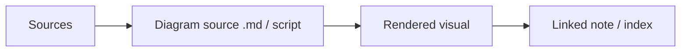

# Assets

> [!TIP] **TL;DR:** Canonical diagrams live as Mermaid Markdown or generated SVG with reproducible source; sources and simplification notes accompany each figure.

**Figure A1.** Source-to-figure flow.  
**Takeaway:** A diagram is reviewable only when its provenance and editable source are preserved.

| File | Contents |
|---|---|
| [Legend](legend.md) | Shared diagram conventions |
| [Hero 01](hero-01-architecture.md) | Architecture map |
| [Hero 02](hero-02-write-path.md) | Write and flush path |
| [Hero 03](hero-03-read-path.md) | Distributed read path |
| [Hero 04](hero-04-hnsw.md) | HNSW traversal |
| [Hero 05](hero-05-ivf.md) | IVF probing |
| [Hero 06](hero-06-pq.md) | PQ and ADC |
| [Hero 07](hero-07-diskann.md) | DiskANN memory/SSD path |
| [Hero 08](hero-08-filtered-search.md) | Filtered search strategies |
| [Hero 09](hero-09-segment-lifecycle.md) | Segment lifecycle |
| [Hero 10](hero-10-sharded-topk.md) | Scatter-gather top-k |
| [Hero 11](hero-11-index-selection.md) | Index selection tree |
| [Hero 12](hero-12-research-lineage.md) | Selected research timeline |

**Start here:** [legend](legend.md), then the [master index](../00-INDEX.md).

