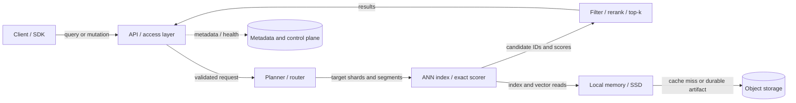

# Hero 01 — Vector database architecture

**Figure 1.** Simplified component map for a vector-search service; boundaries and storage paths vary by product. This is a conceptual map, not an assertion that every product has a separate planner or object store.

**Takeaway:** Retrieval combines request routing, candidate generation, filtering/ranking, and data access; these may be co-located or distributed.

**Sources:** [Milvus architecture documentation](https://milvus.io/docs/architecture_overview.md); [Milvus: A Purpose-Built Vector Data Management System (SIGMOD 2021)](https://doi.org/10.1145/3448016.3457550).

