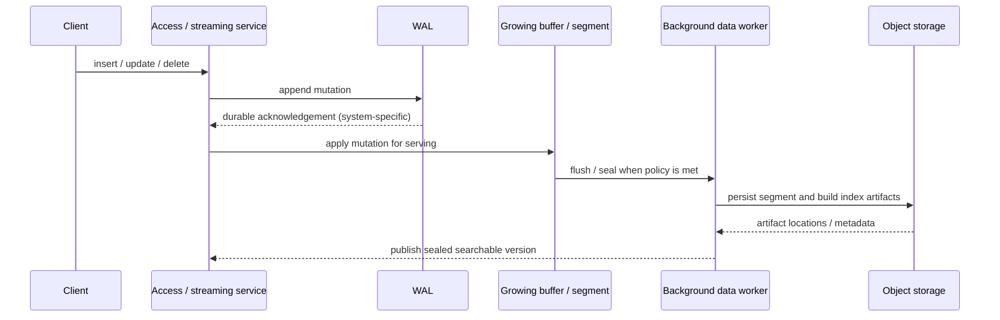

# Hero 02 — Write path and segment lifecycle

**Figure 2.** Simplified WAL-to-segment path, using Milvus terminology. Exact acknowledgement and publication semantics depend on product/version and consistency settings.

**Takeaway:** Durability, freshness, and index readiness are distinct milestones; never infer one from another without checking the system contract.

**Sources:** [Milvus data processing](https://milvus.io/docs/data_processing.md); [Milvus architecture](https://milvus.io/docs/architecture_overview.md).

