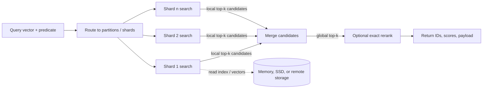

# Hero 03 — Read path: local and distributed

**Figure 3.** Simplified distributed top-k retrieval. A local top-k merge is exact only under compatible scoring and candidate coverage assumptions; ANN candidate generation can already omit true neighbors.

**Takeaway:** Sharding requires local candidate generation plus global reduction; filtering and reranking placement changes both recall and cost.

**Sources:** [Milvus architecture](https://milvus.io/docs/architecture_overview.md); [FAISS paper](https://arxiv.org/abs/1702.08734).

