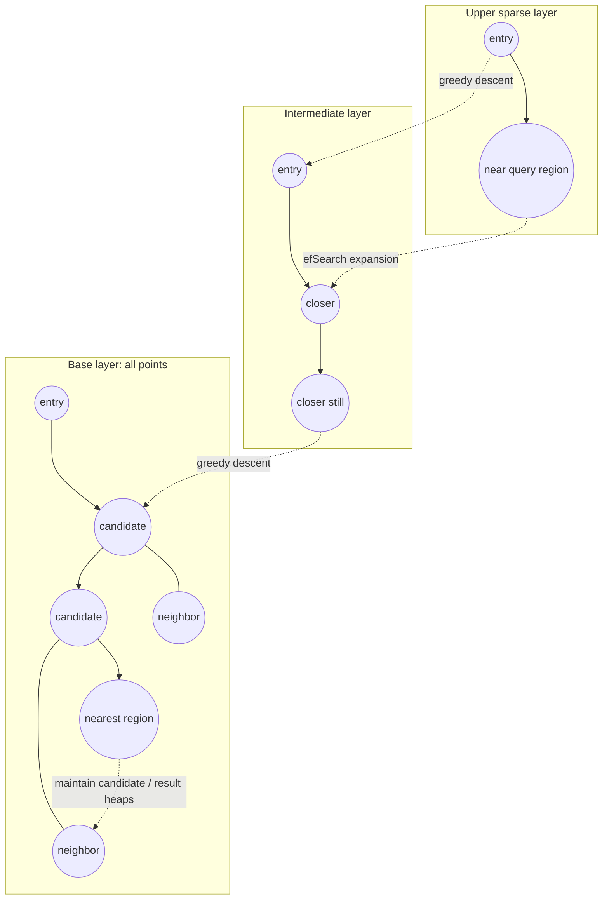

# Hero 04 — HNSW layered search

**Figure 4.** Simplified HNSW traversal across nested proximity graphs. The pictured edges are illustrative, not a particular graph instance; HNSW searches upper layers greedily and performs a broader best-first search on layer 0.

**Takeaway:** Upper layers provide long-range navigation; the base layer spends the query's search budget refining candidates.

**Sources:** [Malkov & Yashunin, HNSW (2016; journal version 2018)](https://arxiv.org/abs/1603.09320).

