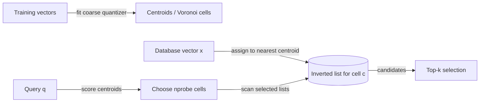

# Hero 05 — IVF coarse-cell probing

**Figure 5.** Inverted-file search: coarse assignment organizes vectors into lists, and query-time probing scans selected lists. The cell shown represents the coarse quantizer; implementations differ in training and assignment details.

**Takeaway:** `nprobe` trades list-scan work against the chance that relevant points lie in unvisited cells.

**Sources:** [FAISS index documentation](https://github.com/facebookresearch/faiss/wiki/Faiss-indexes); [Jégou, Douze & Schmid, PQ (2011)](https://doi.org/10.1109/TPAMI.2010.57).

