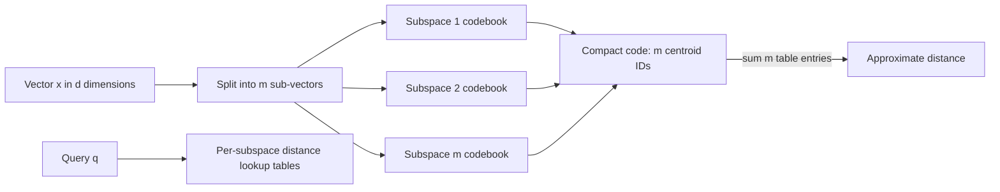

# Hero 06 — Product quantization and ADC

**Figure 6.** Product quantization with asymmetric distance computation (ADC): the query remains full precision while database subvectors are represented by codebook IDs. Diagram is simplified; an implementation stores codebooks and codes separately.

**Takeaway:** PQ lowers vector storage and enables table-based scoring, at the cost of quantization error and training/index complexity.

**Sources:** [Jégou, Douze & Schmid, Product Quantization (TPAMI 2011)](https://doi.org/10.1109/TPAMI.2010.57); [FAISS index overview](https://github.com/facebookresearch/faiss/wiki/Faiss-indexes).

