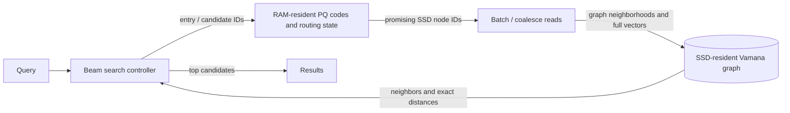

# Hero 07 — DiskANN memory and SSD path

**Figure 7.** Conceptual DiskANN search split. Exact memory-resident structures, SSD layout, and read behavior depend on implementation and version; this is not a universal bill of materials.

**Takeaway:** Disk-based graph ANN spends memory on compact routing aids and uses SSD reads to expand promising candidates.

**Sources:** [Subramanya et al., DiskANN (NeurIPS 2019)](https://proceedings.neurips.cc/paper/2019/hash/09853c7fb1d3f8ee67a61b6bf4a7f8e6-Abstract.html); [Microsoft DiskANN repository](https://github.com/microsoft/DiskANN).

