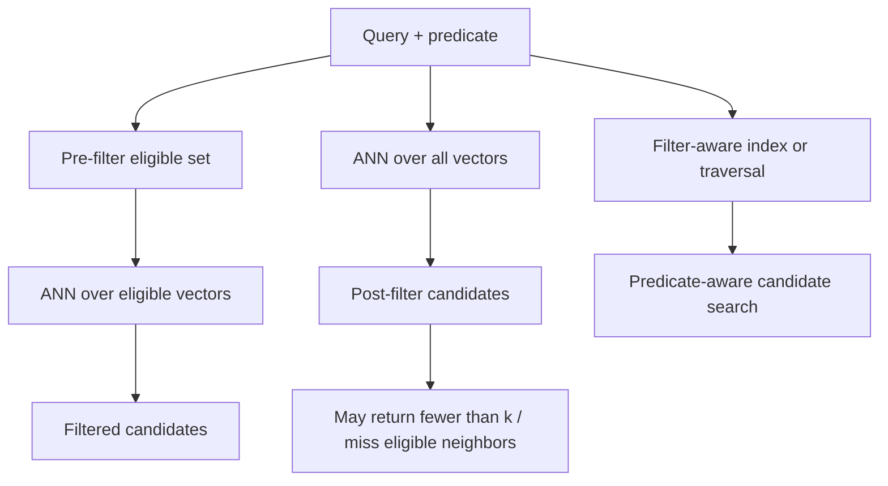

# Hero 08 — Filtered ANN strategies

**Figure 8.** Three common filtered-search patterns. “Pre-filter” may mean an exact scan over a selective subset or a filter-specific index; “native” covers distinct algorithm families such as ACORN and Filtered-DiskANN.

**Takeaway:** Post-filtering can starve the result set; no strategy is best for every selectivity, metadata distribution, and index.

**Sources:** [ACORN (2024)](https://arxiv.org/abs/2403.04871); [Filtered-DiskANN (WWW 2023)](https://doi.org/10.1145/3543507.3583552).

