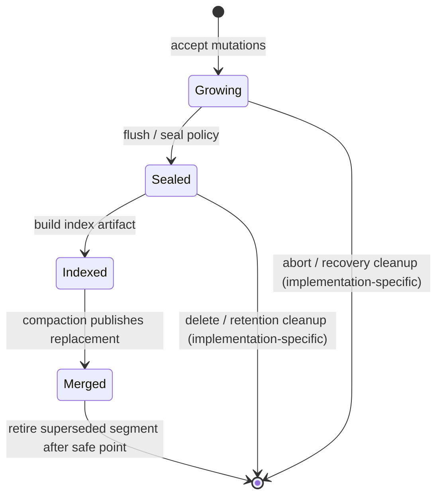

# Hero 09 — Segment lifecycle

**Figure 9.** Simplified lifecycle using Milvus's growing/sealed vocabulary. Real segment states, compaction publication, and reclamation rules are product-specific; arrows are not a universal state machine.

**Takeaway:** Compaction creates replacement data/index views; safe retirement requires coordination with readers, snapshots, and recovery.

**Sources:** [Milvus data processing](https://milvus.io/docs/data_processing.md); [Milvus architecture](https://milvus.io/docs/architecture_overview.md).

