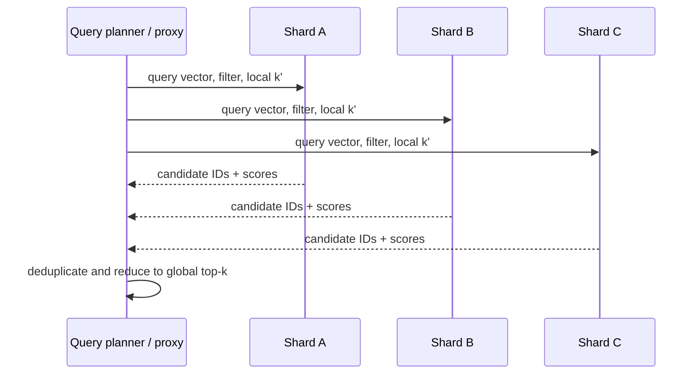

# Hero 10 — Sharded scatter-gather top-k

**Figure 10.** Simplified scatter-gather query. Local `k'` and global top-k correctness depend on score comparability, filters, duplicates, and whether local ANN search is approximate.

**Takeaway:** Global top-k is a merge problem; increasing shard fan-out can raise tail latency and candidate volume.

**Sources:** [Milvus architecture](https://milvus.io/docs/architecture_overview.md); [FAISS paper](https://arxiv.org/abs/1702.08734).

