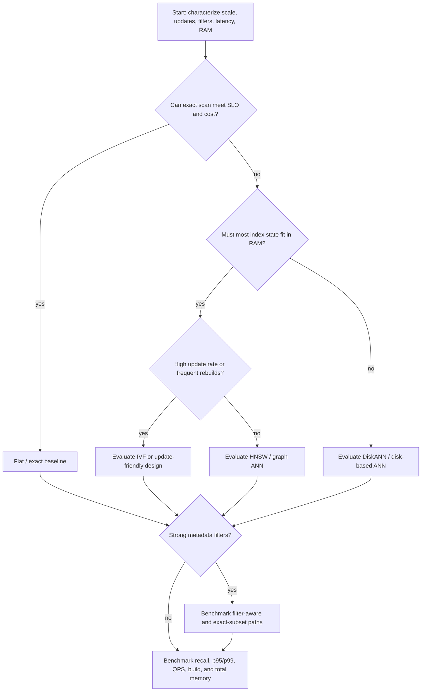

# Hero 11 — Index selection decision tree

**Figure 11.** A starting decision tree, not a product recommendation. Every branch ends in workload-specific measurement; index names alone do not determine behavior.

**Takeaway:** Choose from workload constraints and measured Pareto curves, then validate failure and update behavior.

**Sources:** [FAISS indexes](https://github.com/facebookresearch/faiss/wiki/Faiss-indexes); [ANN-Benchmarks](https://ann-benchmarks.com/); [DiskANN paper](https://proceedings.neurips.cc/paper/2019/hash/09853c7fb1d3f8ee67a61b6bf4a7f8e6-Abstract.html).

