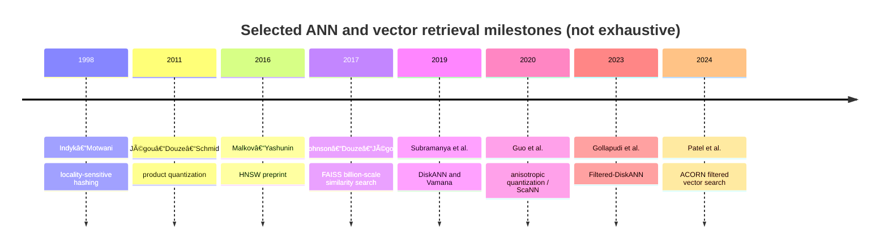

# Hero 12 — Selected research lineage

**Figure 12.** Selected methodological milestones; dates refer to cited publication/preprint records and the timeline is deliberately non-exhaustive.

**Takeaway:** ANN progress has repeatedly shifted the bottleneck: candidate navigation, compressed representation, storage tiering, and predicate-aware traversal.

**Sources:** [Indyk & Motwani (1998)](https://doi.org/10.1145/276698.276876); [PQ (2011)](https://doi.org/10.1109/TPAMI.2010.57); [HNSW (2016)](https://arxiv.org/abs/1603.09320); [FAISS (2017)](https://arxiv.org/abs/1702.08734); [DiskANN (2019)](https://proceedings.neurips.cc/paper/2019/hash/09853c7fb1d3f8ee67a61b6bf4a7f8e6-Abstract.html); [ScaNN (2020)](https://proceedings.mlr.press/v119/guo20h.html); [Filtered-DiskANN (2023)](https://doi.org/10.1145/3543507.3583552); [ACORN (2024)](https://arxiv.org/abs/2403.04871).

