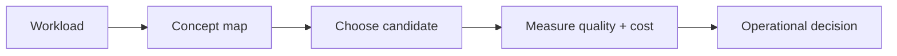

# Cheat sheets

> **TL;DR:** Follow the visual map, then open a focused note for the assumptions, measurement, and references.

**Figure 1: Simplified study path through this section.**

**Takeaway:** Move from the shared foundation to one method at a time, then validate with measurements.

| Topic | Use |
|---|---|
| [All Tldrs](all-tldrs.md) | Start here for the decision summary and linked deep note. |
| [Db Comparison Matrix](db-comparison-matrix.md) | Start here for the decision summary and linked deep note. |
| [Distance Metric Chooser](distance-metric-chooser.md) | Start here for the decision summary and linked deep note. |
| [Failure Mode To Fix](failure-mode-to-fix.md) | Start here for the decision summary and linked deep note. |
| [Hnsw Ivf Pq Tuning](hnsw-ivf-pq-tuning.md) | Start here for the decision summary and linked deep note. |
| [Index Algorithm Comparison](index-algorithm-comparison.md) | Start here for the decision summary and linked deep note. |
| [Memory Sizing](memory-sizing.md) | Start here for the decision summary and linked deep note. |

**Start here:** [Index algorithm comparison](index-algorithm-comparison.md).

**Next:** [Vector databases master index](../00-INDEX.md).
