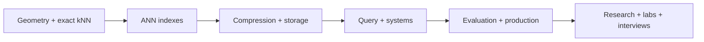

# All TL;DRs

> **TL;DR:** Study in six passes: geometry, indexes, compression/storage, query planning, evaluation/operations, then papers and practice.

**Figure 1: Simplified conceptual view of this topic.**

**Takeaway:** Follow the arrows to see where the method spends work and where the main trade-off enters.

### How to read this

- Follow arrows in the direction data or decisions move.
- The labels name the main components; they do not promise a specific implementation.
- Use the table and field notes below to connect the picture to measurements.

**Visual takeaway:** The diagram shows the main data or decision path; labels are conceptual, not performance guarantees.

## Field notes

| Pass | One-sentence summary |
|---|---|
| Geometry | Embeddings define a metric space; exact kNN defines the quality target. |
| Indexes | ANN methods skip work through partitions, graphs, hashing, or storage tiers. |
| Compression/storage | Smaller codes and durable segments reduce cost but add error and maintenance. |
| Query/systems | Filters and lexical signals change candidate generation and system fit. |
| Evaluation/production | Quality, tails, freshness, and recovery must be measured together. |
| Research/practice | Papers explain mechanisms; reproducible labs test them on controlled workloads. |

## Sources

[ANN survey](https://arxiv.org/abs/1806.09823) · [FAISS paper](https://arxiv.org/abs/1702.08734). Product behavior and defaults can vary by release; pin the version used in any benchmark.

**Next:** [Master index](../00-INDEX.md) · [Glossary](../99-glossary.md).
